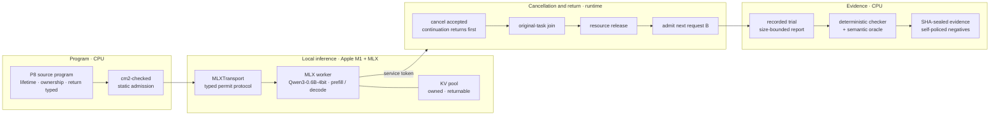

# Response Lab Phi

[简体中文](README.zh-CN.md)

[](https://github.com/phi-media-lab/response-Phi/actions/workflows/cpu-ci.yml)

Response Lab Phi is the local-inference responsiveness and cancellation-semantics
component of the Phi stack. Developed by Phi Media Lab for Apple silicon (the
Apple M1) and the MLX runtime, it studies how a local language-model request can
be cancelled, how its on-device work actually completes, and how GPU-resident
resources hand off to the next request — then turns the safe ordering of those
steps into a property that a checked language subset verifies before a program
runs.

The runtime drives a pinned MLX worker over a typed permit protocol, admits only
programs whose cancellation, ownership, and resource-return discipline
type-checks, and records every run as SHA-sealed evidence that an independent
checker re-verifies for the intended reason. The responsiveness motivation
follows PriML; the real workload is tiny-llm on MLX (Qwen3-0.6B-MLX-4bit); Swift
is the language-modification candidate. Reference source trees and the model
runtime stay read-only and independent.

## System architecture



The checked language owns static admission; the runtime owns the device permit,
the cancel/join/release/admit ordering, and the service-and-tool boundary; the
evidence layer owns independent re-verification. A program reaches the device
only after it type-checks, the next request is admitted only after the previous
one's resources are provably returned, and a claim is credited only after an
independent checker reproduces it for the intended reason. Reference source trees
and the model runtime remain external.

## Apple silicon and the MLX runtime

The project assigns each concern to the surface that owns its dominant cost.

| Stage | Reference hardware/software | Responsibility |
| --- | --- | --- |
| Static admission | CPU · Swift 6+ · checked P8 subset (`cm2-checked`) | Reject programs whose cancellation, ownership, or resource-return discipline is not well-typed, before any device work |
| Local inference | Apple M1 (16 GiB) · MLX · Metal | Run real prefill/decode for the service model (Qwen3-0.6B-MLX-4bit) and hold the KV pool |
| Device transport | `MLXTransport` permit protocol | Grant a single load permit, carry the worker handshake, and close control deterministically |
| Resource handoff | runtime scheduler · `RuntimeCore` ledger | Order cancel-acceptance, original-task join, KV release, and next-request admission while conserving resources across ownership generations |
| Evidence | CPU · deterministic checker + semantic oracle | Record each run under a size-bounded report and re-verify it against SHA-sealed evidence |

Device execution is the admitted MLX worker; every other stage is independently
restartable on CPU and runs after Metal memory is released.

## Composition pipeline

A parent program composes a real service call with a native tool, so the model's
output token crosses into tool code only when the composition is well-typed:

```text
RUN s {
  b    <- call_service(B, tokens)              # real model, Apple M1 + MLX
  info <- call_tool(tokenizer.vocab_symbol, b) # native tool reads the tokenizer
  return Pair(b, info)
}
```

| Stage | Mechanism | Output | Execution surface |
| --- | --- | --- | --- |
| parse / admit | Front-end and checked composition over the P8 parent program | Admitted `RUN` composition | CPU |
| call service B | Drive the real model through the MLX permit protocol | Service token (e.g. `271`) | Apple M1 + MLX |
| call tool | Native tool T01 reads the tokenizer and returns a vocab symbol for the token | Tool result | CPU |
| compose | Return `Pair(b, info)` only after the service and tool obligations are met | Composed parent result | CPU |
| record | Serialize a size-bounded trial that references large inputs by file identity | Recorded evidence | CPU / storage |
| check | Deterministic checker and semantic oracle re-verify ordering, ownership, and content | Independent verdict | CPU |

`src1b-checked` runs the composition under the checked runtime; `src1b-cpu` and
the decoder, parser, and boundary executables isolate each stage for CPU gates.

## Cancellation and resource-return contract

The core scenario: a user cancels request A while it holds KV resources, then
immediately starts request B. Three events are observed separately — cancel
acceptance, safe resource return, and B's first token — and the runtime enforces
a single ordering:

$$
\text{cancel} \;\prec\; \text{join} \;\prec\; \text{release} \;\prec\; \text{admit}(B)
$$

The cancel is accepted and its continuation returns first, so the caller is
released promptly; the original task must still really join and return the KV
pool; only then is B admitted. Each run is measured for correctness, response
latency, throughput, and wasted post-cancel work, with the time origin of every
number stated. A logical gate may check ordering, but never stands in for a
measured device interval, and a simulated delay never substitutes for real GPU
work.

## Current validated envelope

| Established | Requires separate evidence |
| --- | --- |
| Real-model composition on real MLX: service token `271` flows through the native tokenizer tool; ten parent-child composition cases pass | Stable TTFT, p95, or worst-case response bounds — every batch runs small n and makes no stability claim |
| Mechanism ablation across L0 (hand-written) / L1 (library) / L2 (checked PL), reproduced at n=3 on real MLX; tokens `72` / `271` consistent | The full 64-variant T01 negative population — 15 are built and self-policed; the remaining 48 are a per-family oracle-reconstruction campaign |
| The cancel ≺ join ≺ release ≺ admit ordering holds across real-model sessions; the checked-runtime CPU gates pass | Unified P8 language, P3 arrival/dependency, and cross-device (GPU / AMX / device-async) generality |
| Output-size cap enforced both in-runtime and on disk; 15 T01 negatives rejected for the family's intended reason | Perceptual and throughput optimization, and general multi-model support |

The detailed measurements, time origins, and acceptance procedure for each stage
are recorded in the status and conclusions documents below; raw run dumps are
regenerable and kept out of version control.

## Run and study the system

The runtime builds on any Apple-silicon host with a recent Swift toolchain; real
model runs additionally need the tiny-llm MLX environment and the cached
Qwen3-0.6B-MLX-4bit weights.

```bash
# Build the checked runtime and the CPU executables (Apple silicon, Swift 6+)
swift build --package-path runtime -c release

# Re-check the self-policing T01 negative catalog (CPU, no model run)
python3 -I experiments/src1b-convergence-v1/t01-catalog/run_t01_catalog.py \
  --out /tmp/t01-catalog --subset built
```

Focused guides carry the semantics, the experiment contract, and the current
evidence so the README stays a system overview.

| Question | Document |
| --- | --- |
| What are the core cancellation, ownership, and return semantics? | [P8 core semantics](docs/P8_CORE_SEMANTICS.md) · [language subset proposal](docs/P8_LANGUAGE_SUBSET_PROPOSAL.md) |
| What events, metrics, and evidence boundaries govern an experiment? | [Experiment contract](docs/EXPERIMENT_CONTRACT.md) |
| What is independently established, and what still needs evidence? | [Conclusions ledger](docs/CONCLUSIONS.md) · [Platform facts](docs/PLATFORM_FACTS.md) |
| Where are the language gaps that motivate a checked subset? | [Swift expressiveness gaps](docs/SWIFT_EXPRESSIVENESS_GAPS.md) |
| What is the full roadmap and the current status? | [ROADMAP](ROADMAP.md) · [STATUS](STATUS.md) · [handoff](docs/HANDOFF.md) |

## Open-source boundary

The repository publishes the Phi-owned checked runtime, the composition and
mechanism-ablation harnesses, the verification tooling, the conclusions ledger,
and the documentation under Apache-2.0. The MLX runtime and the Qwen3-0.6B model
weights are external dependencies and are not distributed here; the PriML,
tiny-llm, and Swift reference trees are imported read-only with their revision
and environment recorded, and raw result dumps stay out of version control. Each
retains its own terms.

See [LICENSE](LICENSE), [NOTICE](NOTICE), and [THIRD_PARTY_NOTICES.md](THIRD_PARTY_NOTICES.md).
