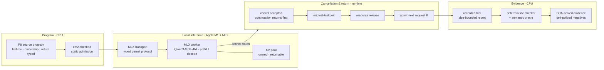

# Response Lab Phi

[English](README.md)

Response Lab Phi 是 Phi 技术栈中研究本地推理响应性与取消语义的组件。由 Phi Media Lab
面向 Apple 芯片(Apple M1)与 MLX 运行时开发,研究本地语言模型请求如何被取消、其设备侧
工作如何真正完成、以及常驻 GPU 的资源如何交接给下一个请求 —— 并把这些步骤的安全次序,
变成一个在程序运行前就能被受检语言子集验证的性质。

运行时通过一套带类型的许可协议驱动一个被钉定的 MLX worker,只接纳取消、所有权与资源归还
纪律能通过类型检查的程序,并把每次运行记录为 SHA 密封的证据,由独立检查器按既定原因复核。
响应性动机来自 PriML;真实负载是 MLX 上的 tiny-llm(Qwen3-0.6B-MLX-4bit);Swift 是语言
改造候选。参考源码树与模型运行时保持只读、独立。

## 系统架构



受检语言负责静态接纳;运行时负责设备许可、cancel/join/release/admit 次序以及服务与工具
边界;证据层负责独立复核。程序只有在通过类型检查后才能到达设备,下一个请求只有在上一个
请求的资源被可证明地归还后才被接纳,一条结论只有在独立检查器按既定原因复现后才被记入。
参考源码树与模型运行时始终在仓外。

## Apple 芯片与 MLX 运行时

本项目把每项职责交给承担其主要成本的执行面。

| 阶段 | 参考硬件/软件 | 职责 |
| --- | --- | --- |
| 静态接纳 | CPU · Swift 6+ · 受检 P8 子集(`cm2-checked`) | 在任何设备工作之前,拒绝取消、所有权或资源归还纪律不良类型的程序 |
| 本地推理 | Apple M1(16 GiB)· MLX · Metal | 为服务模型(Qwen3-0.6B-MLX-4bit)运行真实 prefill/decode 并持有 KV 池 |
| 设备传输 | `MLXTransport` 许可协议 | 授予单次加载许可、承载 worker 握手、并确定性地关闭控制 |
| 资源交接 | 运行时调度 · `RuntimeCore` 账本 | 安排取消受理、原任务 join、KV 释放与下一请求准入,并跨所有权世代守恒资源 |
| 证据 | CPU · 确定性检查器 + 语义 oracle | 在有界报告下记录每次运行,并对照 SHA 密封证据复核 |

设备执行就是被接纳的 MLX worker;其余每个阶段都可在 CPU 上独立重启,并在 Metal 内存释放
后运行。

## 组合流水线

父程序把一次真实服务调用与一个原生工具组合起来,使模型输出的 token 只有在组合良类型时
才跨入工具代码:

```text
RUN s {
  b    <- call_service(B, tokens)              # real model, Apple M1 + MLX
  info <- call_tool(tokenizer.vocab_symbol, b) # native tool reads the tokenizer
  return Pair(b, info)
}
```

| 阶段 | 机制 | 输出 | 执行面 |
| --- | --- | --- | --- |
| 解析 / 接纳 | 前端与对 P8 父程序的受检组合 | 已接纳的 `RUN` 组合 | CPU |
| 调用服务 B | 经 MLX 许可协议驱动真实模型 | 服务 token(如 `271`) | Apple M1 + MLX |
| 调用工具 | 原生工具 T01 读取 tokenizer,返回该 token 的 vocab 符号 | 工具结果 | CPU |
| 组合 | 仅在服务与工具义务满足后返回 `Pair(b, info)` | 组合后的父结果 | CPU |
| 记录 | 序列化有界 trial,大输入按文件身份引用 | 记录的证据 | CPU / 存储 |
| 检查 | 确定性检查器与语义 oracle 复核次序、所有权与内容 | 独立判定 | CPU |

`src1b-checked` 在受检运行时下执行该组合;`src1b-cpu` 与 decoder、parser、boundary
可执行文件把各阶段隔离用于 CPU 门。

## 取消与资源归还合同

核心情境:用户在请求 A 仍占用 KV 资源时取消它,随即启动请求 B。三个事件被分别观察 ——
取消受理、资源安全归还、B 的首 token —— 运行时强制单一次序:

$$
\text{cancel} \;\prec\; \text{join} \;\prec\; \text{release} \;\prec\; \text{admit}(B)
$$

取消被受理且其 continuation 先返回,调用方因此被迅速释放;原任务仍必须真正 join 并归还
KV 池;唯有此后 B 才被接纳。每次运行就正确性、响应延迟、吞吐与取消后无效工作进行测量,
并标明每个数值的时间原点。逻辑门可以检查次序,但绝不替代被测设备区间,模拟时延也绝不替代
真实 GPU 工作。

## 当前已验证范围

| 已确立 | 需另行取证 |
| --- | --- |
| 真实 MLX 上的真实模型组合:服务 token `271` 流经原生 tokenizer 工具;十个父子组合情境通过 | 稳定的 TTFT、p95 或最坏响应界 —— 每批次 n 都很小,不作稳定性结论 |
| L0(手写)/ L1(库)/ L2(受检 PL)三级别机制消融,在真实 MLX 上以 n=3 复现;token `72` / `271` 一致 | 完整 64 变体 T01 负例族 —— 已建 15 个并自监管,其余 48 个是按族逆向 oracle 的工程 |
| cancel ≺ join ≺ release ≺ admit 次序跨真实模型会话成立;受检运行时 CPU 门通过 | 统一 P8 语言、P3 到达/依赖,以及跨设备(GPU / AMX / device-async)一般性 |
| 产出大小上限在运行时与磁盘两侧强制;15 个 T01 负例因各族既定原因被拒 | 感知与吞吐优化,以及一般多模型支持 |

各阶段的详细测量、时间原点与验收流程记录在下列状态与结论文档中;原始运行转储可再生,
不入版本库。

## 运行与研究本系统

运行时可在任何装有较新 Swift 工具链的 Apple 芯片主机上构建;真实模型运行另需 tiny-llm
的 MLX 环境与已缓存的 Qwen3-0.6B-MLX-4bit 权重。

```bash
# 构建受检运行时与 CPU 可执行文件(Apple 芯片,Swift 6+)
swift build --package-path runtime -c release

# 复核自监管的 T01 负例目录(CPU,不跑模型)
python3 -I experiments/src1b-convergence-v1/t01-catalog/run_t01_catalog.py \
  --out /tmp/t01-catalog --subset built
```

聚焦指南承载语义、实验合同与当前证据,使 README 保持为系统概览。

| 问题 | 文档 |
| --- | --- |
| 核心的取消、所有权与归还语义是什么? | [P8 核心语义](docs/P8_CORE_SEMANTICS.md) · [语言子集提案](docs/P8_LANGUAGE_SUBSET_PROPOSAL.md) |
| 哪些事件、指标与证据边界约束一次实验? | [实验合同](docs/EXPERIMENT_CONTRACT.md) |
| 什么已被独立确立,什么还需取证? | [结论账本](docs/CONCLUSIONS.md) · [平台事实](docs/PLATFORM_FACTS.md) |
| 促成受检子集的语言缺口在哪里? | [Swift 表达缺口](docs/SWIFT_EXPRESSIVENESS_GAPS.md) |
| 完整路线与当前状态? | [ROADMAP](ROADMAP.md) · [STATUS](STATUS.md) · [交接](docs/HANDOFF.md) |

## 开源边界

本仓以 Apache-2.0 发布 Phi 自有的受检运行时、组合与机制消融脚手架、验证工具、结论账本与
文档。MLX 运行时与 Qwen3-0.6B 模型权重是外部依赖,不在此分发;PriML、tiny-llm 与 Swift
参考源码树以只读方式导入,并记录其修订与环境,原始结果转储不入版本库。各自保留其条款。

见 [LICENSE](LICENSE) 与 [NOTICE](NOTICE)。
